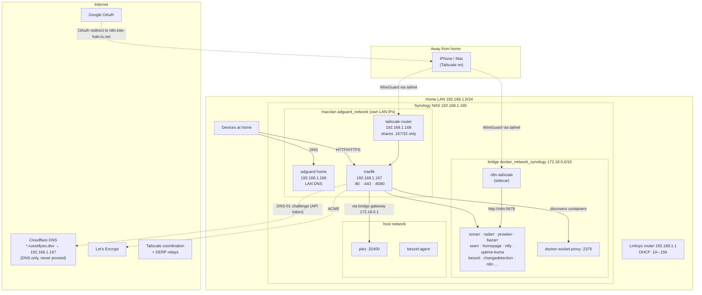
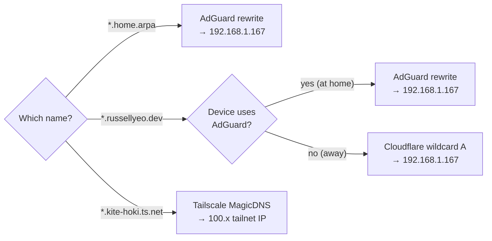
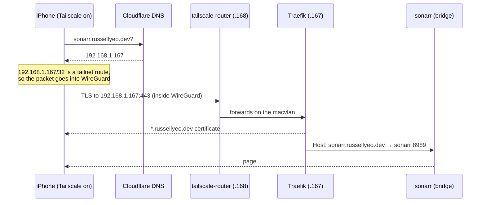
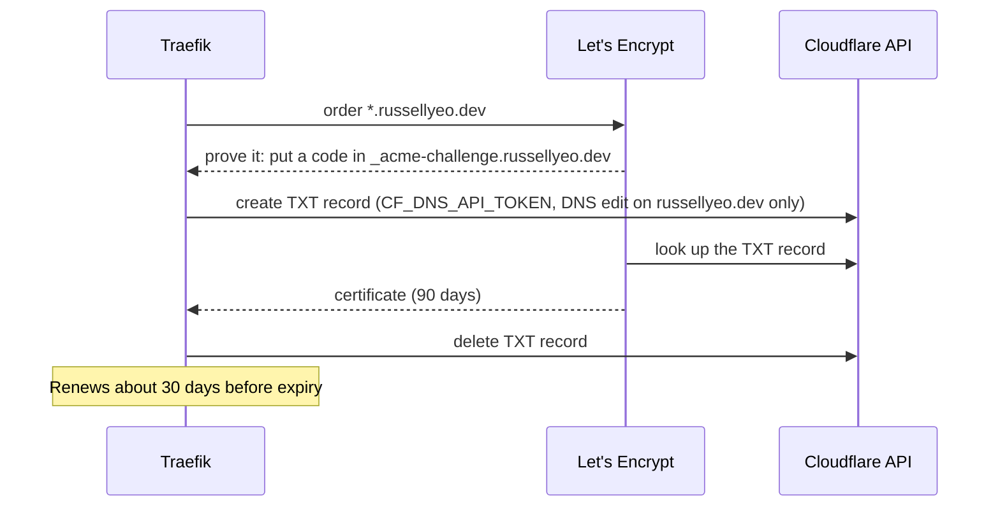

# Architecture: networking

How a request gets from a phone or laptop to a container on the Synology NAS.
Diagrams are [Mermaid](https://mermaid.js.org/), so GitHub, VS Code and
Obsidian draw them, and they're edited as text next to the code they describe.

## The big picture



## Addresses

| What | Address | Notes |
|---|---|---|
| Router | `192.168.1.1` | DHCP hands out `.10`–`.159`. `.160`–`.254` is for fixed addresses. DNS 1 is AdGuard, DNS 2 is `1.1.1.1`. |
| NAS | `192.168.1.165` | Host ports for Transmission (`9091`, `9191`, `9291`, `9391`) and direct app ports |
| AdGuard Home | `192.168.1.166` | macvlan. LAN DNS for every device. |
| Traefik | `192.168.1.167` | macvlan + bridge. `:80` HTTP, `:443` HTTPS, `:8080` dashboard API |
| tailscale-router | `192.168.1.168` | macvlan. Tailscale subnet router for `192.168.1.167/32` only |
| Docker bridge | `172.18.0.0/16` | Gateway `172.18.0.1` is how bridge containers reach host-network ones |

## Names

Every service behind Traefik answers on two names:

| Name | Protocol | Resolved by | Works |
|---|---|---|---|
| `http://<service>.home.arpa` | HTTP | AdGuard rewrite | At home, even offline |
| `https://<service>.russellyeo.dev` | HTTPS (redirects from HTTP) | Cloudflare wildcard record, and an AdGuard rewrite | At home (even offline), and away with Tailscale on |
| `https://n8n.kite-hoki.ts.net` | HTTPS | Tailscale MagicDNS | On the tailnet. n8n's Google OAuth callback and email links. |



Both AdGuard rewrites are set by the `adguard-home` role (`adguard_rewrites`).
The Cloudflare record was added by hand.

## A request from away

`https://sonarr.russellyeo.dev` on the phone, on mobile data:



At home the same request goes from the device straight to Traefik, or through
`tailscale-router` over the LAN when Tailscale is on.

## Certificates

Traefik holds one Let's Encrypt certificate for `*.russellyeo.dev`, stored in
`{{ config_directory }}/traefik/acme/acme.json`. Wildcards need the DNS-01
challenge, so nothing has to be open to the internet:



If the Cloudflare token stops working, renewals fail, and the certificate
lapses about 30 days later. Traefik logs the failure.

## Why it's shaped like this

- **Traefik and AdGuard are on a macvlan** so they get their own LAN IPs and
  ports `53`, `80` and `443` without clashing with DSM.
- **A macvlan container can't reach its own host, and the host can't reach
  it.** Three things follow:
  - Traefik reaches host-network Plex through the bridge gateway
    `172.18.0.1` (`roles/traefik/templates/dynamic/plex.toml.j2`).
  - The NAS's own Tailscale can't route to Traefik, so `tailscale-router`
    sits on the macvlan beside it.
  - Debug Traefik backends from inside the Traefik container, not from a
    laptop.
- **`tailscale-router` shares one address, not the LAN.** Tailnet devices can
  reach Traefik's services, but not DSM, the router or other devices.
- **n8n keeps its own Tailscale sidecar.** Google OAuth needs an HTTPS
  callback, and `https://n8n.kite-hoki.ts.net` is registered with Google. See
  `roles/n8n/README.md`.
- **Nothing is reachable from the internet.** No router ports are forwarded,
  the Cloudflare record is "DNS only" to a private IP, and there's no
  Cloudflare tunnel.
- **Some apps check the hostname.** Sonarr only answers to names in its
  `<AllowedHosts>`, which the `sonarr` role sets, and Homepage only answers
  names in `HOMEPAGE_ALLOWED_HOSTS`. A new name for those needs adding there
  too.

## Adding a service

1. Put it on `{{ docker_network }}`.
2. Give it Traefik labels for both names and both entrypoints:
   ```yaml
   traefik.enable: "true"
   traefik.http.routers.<name>.rule: "Host(`<name>.{{ home_domain }}`) || Host(`<name>.{{ public_domain }}`)"
   traefik.http.routers.<name>.entrypoints: "web,websecure"
   traefik.http.services.<name>.loadbalancer.server.port: "<port>"
   homepage.href: "https://<name>.{{ public_domain }}"
   ```
3. Nothing else: the wildcard DNS records, the certificate and the tailnet
   route already cover every `*.russellyeo.dev` name.

## Manual pieces (not in Ansible)

| Piece | Where |
|---|---|
| `*.russellyeo.dev` A record → `192.168.1.167`, DNS only | Cloudflare dashboard |
| Cloudflare API token (Zone → DNS → Edit, `russellyeo.dev`) | Cloudflare, then `vault_cloudflare_dns_api_token` |
| `192.168.1.167/32` route approval, key expiry disabled for `tailscale-router` and `n8n` | Tailscale admin console |
| DHCP range `.10`–`.159`, DNS servers | Linksys router |
| Everything in `AdGuardHome.yaml` except the rewrites | AdGuard web UI |
