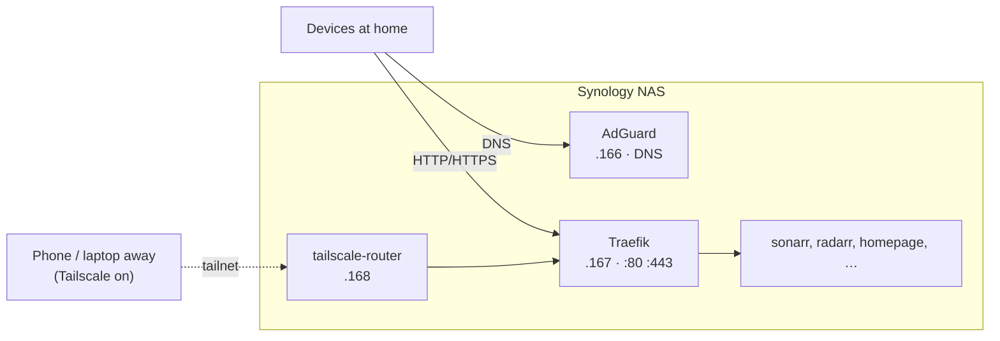

# Architecture: networking

How a request gets from a phone or laptop to a container on the NAS.

## Names

| Name | Looked up by | Works |
|---|---|---|
| `https://<service>.russellyeo.dev` | AdGuard at home, Cloudflare away. Both → `192.168.1.167` | Home, and away with Tailscale on |
| `http://<service>.home.arpa` | AdGuard | Home only |
| `https://n8n.kite-hoki.ts.net` | Tailscale | Tailnet. Needed for n8n's Google login. |

Traefik holds one Let's Encrypt wildcard certificate for `*.russellyeo.dev`,
proved through Cloudflare DNS, so nothing has to be open to the internet.

## Why it's shaped like this

- **Traefik and AdGuard have their own LAN IPs** (a macvlan), so they can use
  ports 53, 80 and 443 without clashing with DSM.
- **A macvlan container and its host can't talk to each other.** So Traefik
  reaches Plex through the bridge gateway `172.18.0.1`, and the tailnet gets
  in through `tailscale-router` beside Traefik, not the NAS's own Tailscale.
- **The tailnet can reach Traefik only**, not the rest of the LAN.
- **Nothing is reachable from the internet.** The Cloudflare record points at
  a private IP, and no ports are forwarded.

## Set up by hand (not in Ansible)

- Cloudflare: `*.russellyeo.dev` A record → `192.168.1.167` (DNS only), and
  the API token in `vault_cloudflare_dns_api_token`
- Tailscale admin: approve the `192.168.1.167/32` route, key expiry off for
  `tailscale-router` and `n8n`
- Router: DHCP `.10`–`.159`, DNS 1 = AdGuard
